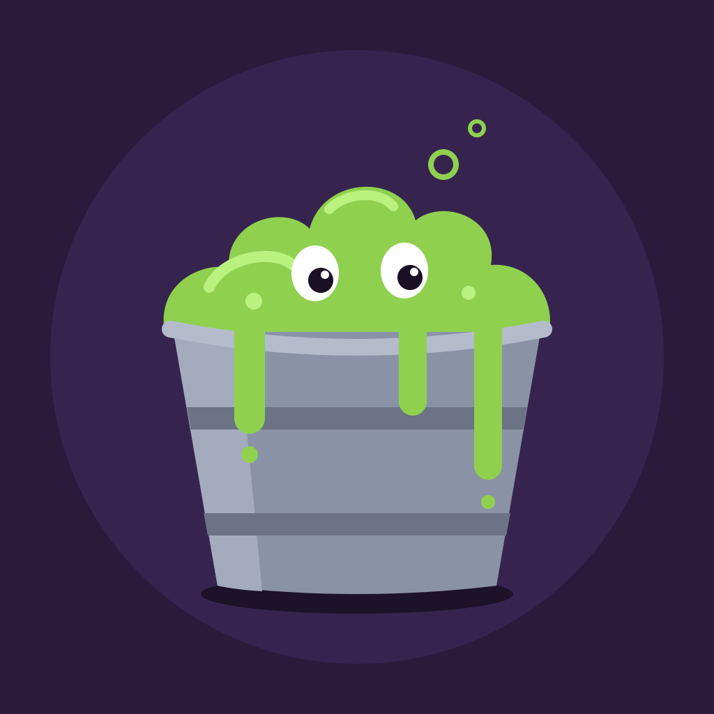

# Slopkeeper

Keeper of the slop. A Discord bot for friends servers that helps people get together, figure out what to play once they're there, and remember the night afterwards. One running bot can serve several servers, each with its own settings and data.

- **[Getting together](docs/getting-together.md):** pings people who opted in when a voice channel fills up, with per-game pings for the games being played, and plans game nights people can RSVP to.
- **[Picking a game](docs/games.md):** knows everyone's Steam library and picks a multiplayer game that the people in voice all own.
- **[Getting games](docs/deals.md):** posts when a game the group wants goes on sale, on Steam or cheaper on another official store, pinging whoever still needs it, and when a game is free to keep on Steam, Epic or GOG.
- **[Remembering the night](docs/stats.md):** recaps each voice session, keeps a weekly leaderboard, tracks what everyone plays, per person and for the whole server, and posts a recap of each month.
- **Messing around:** a [soundboard](docs/soundboard.md) that layers different sounds like Discord's own and restarts a spammed one without a gap, with short clips mirrored into Discord's soundboard, [text to speech](docs/speech.md) and [music](docs/music.md).

Everything happens through slash commands (type `/` in any channel, or run `/help`), a few **Apps** on messages and members (right-click, or press and hold on a phone), and automatic posts in each server's announce channel.

## A typical night

1. On Tuesday, Sam runs `/gamenight plan game:Valheim when:fri 9pm`. The bot posts an RSVP card with **In / Maybe / Can't** buttons, pings the **Valheim** game role, and adds a Discord event to the server's event list. Four people click **In**.
2. On Friday at 8:45, the bot reminds the four of them. At 9 PM, Sam joins voice. Alex joins a minute later, and the channel now has 2 people. Slopkeeper posts in the announce channel:
   > @hop-on 🎮 **Sam** and **Alex** are in #general-voice, playing **Deep Rock Galactic**. Hop on!

   Everyone who ran `/notify` gets pinged, along with the Deep Rock Galactic game role, and two more people join.
3. Nobody can agree on a game, so someone runs `/whatdoweplay`. The bot checks the Steam libraries of the 4 people in voice and replies:
   > 🎲 **Lethal Company**. All 4 of you own it.
   > **Also works (6):** Deep Rock Galactic, Valheim, …
   > **One purchase away:** Helldivers 2 · needs @Jordan

   **Reroll** picks another game; **Never suggest this** hides one for good.
4. Throughout the night, people spam the soundboard panel.
5. Everyone leaves at 1 AM. Five minutes after the channel empties, the bot posts a recap: the session lasted 4h, Sam was there for 4h, Alex for 3h 40m, and so on, plus the games people were playing.
6. On Sunday evening, the bot posts the week's voice leaderboard. `/gamestats` shows the server put 31 hours into Lethal Company this month, and `/gamestats user:@Alex` shows where Alex's evenings went.
7. Days later, Helldivers 2 goes 40% off. They've been playing it, so the bot posts the sale and pings Jordan, the only one who doesn't have it. The same week, it posts in #free-games that a game is free to keep on Epic.

## Getting started (for everyone in the server)

1. **`/steam link profile:<your Steam profile URL>`** so the picker knows your games. In Steam, set **Profile → Edit Profile → Privacy Settings → Game details** to **Public**; otherwise the bot can't see your library.
2. **`/pings`** to pick what you get pinged for: people hopping in voice, and each game you play (when people play it, or plan a game night for it). `/notify` turns just the hop-on pings on or off.
3. That's it. The rest works on its own or when someone runs a command. `/help` lists every command.

## Set it up

- **Adding it to your server:** [Setting up a server](docs/server-setup.md) covers inviting the bot, `/setup` and every setting.
- **Running it yourself:** [Hosting the bot](docs/self-hosting.md) covers the Discord application, Docker and the optional voice, music and loop containers.

## Docs

- [Getting together](docs/getting-together.md): hop-on pings, game pings and game nights
- [Playing games](docs/games.md): Steam accounts, What do we play?, the game library, achievements and patch notes
- [Sales and free games](docs/deals.md): sale alerts, other stores, bundles and free games
- [Stats](docs/stats.md): session recaps, leaderboards, game stats, comparing two people and the monthly recap
- [Soundboard](docs/soundboard.md): playing, adding and managing sounds, the looping room and Discord's soundboard
- [Text to speech](docs/speech.md): `/say`, the voices and adding your own
- [Music](docs/music.md): the shared queue, Autoplay and playlists
- [Web UI](docs/web-ui.md): every page, and signing in through Pangolin
- [Setting up a server](docs/server-setup.md): adding the bot, `/setup`, every setting and its default, and several servers on one bot
- [Self-hosting](docs/self-hosting.md): the application, Docker, the environment variables and the extra containers
- [Management API and performance numbers](docs/api.md): for tools and for keeping an eye on the bot
